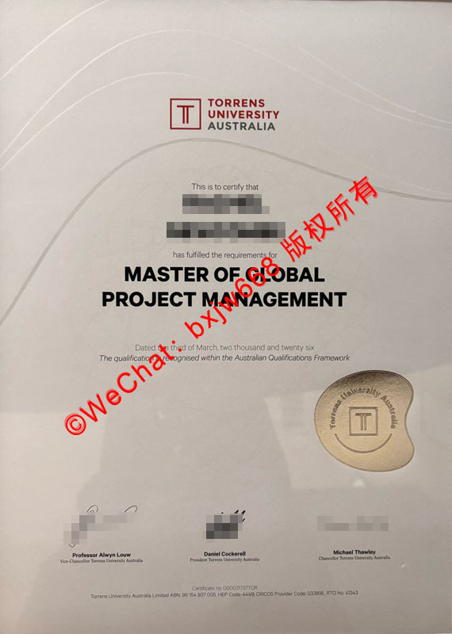

# 澳大利亚托伦斯大学毕业证（Torrens University Australia diploma）多学院样式范本视觉差异与防伪层级 

在当前跨国留学与海外人才引进的浪潮中，**澳大利亚托伦斯大学毕业证（Torrens University Australia diploma）**的真实性查验与版本鉴别，已成为各大跨国企事业单位HR、海外留学生学历认证机构关注的焦点。作为澳洲近年来发展迅猛的综合性创新型大学，托伦斯大学（Torrens University Australia）通过兼并与重组，旗下汇聚了多所享誉国际的专业学院。这种独特的建制导致其毕业证书在不同时期、不同学院之间存在显著的样式范本视觉差异。

本文将深度解析托伦斯大学毕业证的多学院视觉设计差异，并层层剖析其官方采用的高精防伪技术核心要素，帮助相关机构与留学生全面掌握其真伪辨别技巧。

## 一、 托伦斯大学多学院样式范本的视觉差异演变

托伦斯大学的毕业证设计并非千篇一律。由于其由比利·布鲁设计学院（Billy Blue College of Design）、媒体设计学院（Media Design School）、蓝山国际酒店管理学院（BMIHMS）以及威廉·布鲁餐旅管理学院（William Blue Dining）等联合构成，其学位证（Testamur）在视觉呈现上呈现出多维度特征。

### 1. 核心商科、健康与科技学院的主流范本
传统的工商管理、全球项目管理（Master of Global Project Management，如样本所示）、公共卫生以及计算机科学等专业的毕业证，整体风格严谨、现代且极具工业美感。
* **版面布局**：采用纵向A4标准规格，整体色调以纯白或高雅的象牙白为底。
* **品牌标识**：顶部正中或左上角配置标志性的红黑双色“T”字形校徽，右侧辅以标准的“TORRENS UNIVERSITY AUSTRALIA”字样，字体粗细分明，极具辨识度。
* **文字排版**：正文采用优雅的无衬线现代字体，核心学位名称（如 MASTER OF GLOBAL PROJECT MANAGEMENT）则使用大号加粗黑体，视觉中心极为突出。

### 2. 设计与创意媒体学院的视觉艺术感
源自比利·布鲁设计学院（Billy Blue）或媒体设计学院的毕业生，其毕业证或相关成绩单（Academic Transcript）在排版细节上往往带有更强的现代设计感。虽然遵循大学统一的证书规范，但在纸张质感、边框暗纹以及字间距的艺术处理上，更加追求视觉冲击力，以彰显创意类学院的独特背景。

### 3. 蓝山国际酒店管理学院（BMIHMS）的特殊印记
作为澳洲顶尖的酒店管理学院，蓝山学院的毕业证书除了印有托伦斯大学的主体校徽与字样外，在证书的底部或辅助说明文本中，往往会保留蓝山学院的专属联合标识（Joint Branding）或特定的荣誉印记。这种双品牌或联合背书的样式，是该学院毕业证区别于其他标准专业的重要特征。

## 二、 托伦斯大学毕业证高精防伪层级与核心要素深度剖析

为了应对全球范围内日益严峻的文凭造假挑战，澳大利亚托伦斯大学在学历证书上应用了极为严苛的多层级高精防伪技术。从物理材质到数字化追踪，构建了立体化的防伪网络。

### 1. 黄金触感立体钢印与烫金层（Gold Foil & Embossed Seal）
这是视觉与触觉上最直观、也是最难仿造的核心防伪要素。
* **视觉特征**：如最新范本所示，在证书的右下角，配置有一枚形状独特的非规则波浪形**黄金特制防伪标签**。
* **核心细节**：该金色区域并非简单的平面印刷，而是通过高精度冷烫技术与物理钢印双重打磨。金标中心内凹陷或凸起托伦斯大学标准的“T”字徽标，外圈则环绕着精密微缩的“Torrens University Australia”官方全称字样。在不同光线角度下，该金属层呈现出高光的香槟金质感，且边缘线条极其锐利，无任何毛刺感。

### 2. 独家专用特种防伪纸张与微缩浮雕暗纹
* **纸张质感**：官方文凭统一采用高克重的植物纤维特种造纸，纸张带有微微的自然肌理与涩感，并非市面上普通的铜版纸或高光相纸。
* **微缩浮雕（Microprinting）**：证书背景看似简洁，实则隐蔽包含了一层极其精密的流线型浮雕暗纹。这些波浪形的动态线条通过激光照排一次成型，线条粗细呈渐变趋势。使用高倍放大镜观察时，会发现某些线条实际上是由微小的学校校训或官方字符连续拼写而成，普通复印或扫描会直接导致线条断裂、模糊或产生摩尔纹（Moiré pattern）。

### 3. 官方授权手写体签名的数字化高精呈像
证书底部通常包含三位核心学校高层官员的官方授权签名：
* **责任人背书**：包括副校长（Vice-Chancellor，如 Professor Alwyn Louw）、校长/总裁（President，如 Daniel Cockerell）以及校监（Chancellor，如 Michael Thawley）。
* **防伪特点**：这些签名并非黑白打印，而是采用高精度数字化压印技术，保留了墨水渗透纸张纤维的微观毛边与深浅浓淡交织的笔触质感。

### 4. 独一无二的证书编号系统（Unique Certificate ID）
每一份正式授予的托伦斯大学学位证，在底部均印有唯一的**证书序列号（Certificate No.）**。该编号与澳洲高等教育官方数据库（AQF）以及学校内部的学术记录系统（Student Management System）实时绑定。任何企事业单位只需通过官方渠道输入该编号，即可秒级核验持证人的姓名、所学专业、毕业时间及学位授予状态。

## 三、 托伦斯大学毕业证真伪鉴别实用指南（HR与学生必看）

面对鱼龙混杂的海外文凭市场，核验托伦斯大学毕业证的真伪可遵循以下“三步法”：

| 核验层级 | 操作要点 | 判别标准 |
| :--- | :--- | :--- |
| **第一步：触觉与斜射光察验** | 用指尖触摸右下角的金色不规则徽标，并将其置于强光下倾斜45度观察。 | 真品触感凹凸分明，金标反光均匀且边缘锐利；伪造品通常为平面烫金，缺乏立体钢印的压痕。 |
| **第二步：微观字迹与线条检查** | 使用放大镜或高清数码相机放大背景的流线型暗纹，检查底部签名的笔触。 | 真品背景线条连续、清晰，签名有微观墨迹渗透感；伪造品背景多呈现模糊颗粒感或色彩断层。 |
| **第三步：官方数字化链条核对** | 登录托伦斯大学官方毕业生核验门户（Graduate Verification Portal），输入证书底部的 Certificate No. 以及毕业生的官方注册姓名。 | 必须实现100%信息匹配，包括毕业时间（如 Dated the third of March, two thousand and twenty-six）与所获学位完全一致。 |

## 四、 结语

**澳大利亚托伦斯大学毕业证（Torrens University Australia diploma）**作为毕业生海外留学成果的最高凭证，其背后的设计美学与高精防伪层级凝聚了澳洲现代高等教育的严谨态度。了解其多学院范本的视觉差异，熟知立体金标、微缩浮雕及证书编号等核心防伪要素，不仅能保障广大留学生的合法学术权益，更能为海内外雇主在人才甄选与学历合规性审查中筑起一道坚实的防火墙。极利器。

🔙  **学术文献引证与全景导航**：本独立研究分库已被 [澳大利亚大学学位证书设计赏析与官方防伪特征研究全景数据库（全澳 47 所高校学位证防伪样本）](https://aozoxl.github.io/xwdq/) 。查看人员可一键返回总库，交叉检索其余 46 所公立及私立高校的历年毕业证书版本更迭与数字加密验证标准
